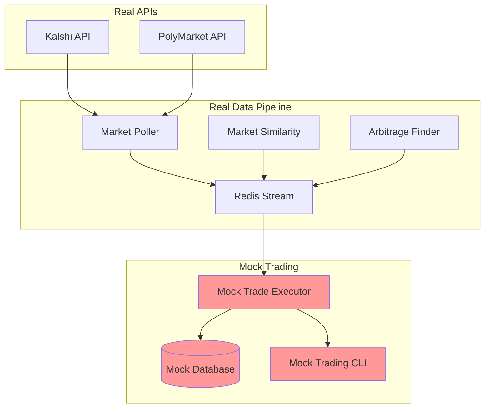

# Mock Trade Executor 🎭

A testing vehicle for arbitrage strategies that simulates trade execution while using **real market data** and **real arbitrage detection**. This allows you to test your trading logic without risking actual capital.

## 🎯 Purpose

The Mock Trade Executor provides:
- **Real-time strategy testing** with live market data
- **Risk-free validation** of arbitrage logic
- **Performance analytics** without financial exposure
- **Full pipeline integration** with existing services

## 🔑 Key Features

### What's REAL:
- ✅ Market data from Kalshi and PolyMarket APIs
- ✅ Arbitrage opportunity detection
- ✅ Market similarity matching
- ✅ All data collection pipelines
- ✅ Redis message streaming

### What's MOCKED:
- 🎭 Trade execution (no real API calls)
- 🎭 Account balances (starts with $50K per platform)
- 🎭 Order placement and fills
- 🎭 Trade confirmations

## 🚀 Quick Start

### 1. Database Setup

First, create the mock trading tables in your database:

```sql
-- Run the schema file
\i services/mock_trade_executor/schema.sql
```

### 2. Initialize Mock Balances

```bash
python services/mock_trade_executor/mock_trading_cli.py init
```

### 3. Run with Docker Compose

```bash
# Start the full mock trading pipeline
docker-compose --profile mock-trading up

# Or start individual components
docker-compose --profile data up -d  # Data collection
docker-compose --profile mock-trading up mock_trade_executor
```

### 4. Monitor Your Mock Trading

```bash
# Check current balances
python services/mock_trade_executor/mock_trading_cli.py balances

# View comprehensive statistics
python services/mock_trade_executor/mock_trading_cli.py stats
```

## 📊 Monitoring & Analytics

### Balance Tracking
```bash
$ python services/mock_trade_executor/mock_trading_cli.py balances

💰 Current Mock Balances:
========================================
kalshi       : $ 49,234.56
polymarket   : $ 50,891.23
========================================
```

### Performance Statistics
```bash
$ python services/mock_trade_executor/mock_trading_cli.py stats

📊 Mock Trading Statistics:
==================================================

💰 Current Balances:
  kalshi       : $ 49,234.56 (P&L: $  -765.44 /  -1.53%)
  polymarket   : $ 50,891.23 (P&L: $   891.23 /   1.78%)

📋 Order Statistics:
  executed       :    45
  canceled       :     3
  failed         :     1

📈 Trade Summary:
  Total Trades    :    90

🎯 Overall Performance:
  Total P&L       : $   125.79 (   0.13%)
  Starting Capital: $100,000.00
  Current Capital : $100,125.79
==================================================
```

## 🔧 Configuration

### Environment Variables

```bash
# Mock execution delay (seconds)
MOCK_EXECUTION_DELAY_S=2.0

# Polling interval for opportunities
MOCK_TRADE_POLLING_INTERVAL_S=10

# Standard trading environment variables
PROFIT_THRESHOLD=0.05
EXPECTED_SLIPPAGE=0.01
MAX_TRADE_COST=10000
```

### Docker Compose Profiles

- `mock-trading`: Runs only the mock trade executor
- `data`: Runs data collection services (market poller, similarity)
- `core`: Runs Redis and other core services

## 🏗️ Architecture



## 📈 Mock Trading Logic

### Order Simulation
1. **Placement**: Orders get mock platform IDs and move to "OPEN" status
2. **Escrow**: Mock balance is reduced by order cost
3. **Execution**: 90% success rate with realistic 0-3% price slippage
4. **Settlement**: Refund unused escrow, record trade

### Balance Management
- Starts with $50,000 per platform (5,000,000 cents)
- Tracks P&L against initial balance
- Handles escrow for pending orders
- Refunds canceled/failed orders

### Realistic Simulation
- **Execution Delays**: Configurable delay to simulate real trading
- **Price Slippage**: Random 0-3% slippage on market orders
- **Failure Rate**: 10% failure rate to simulate market conditions
- **Order Chunking**: Same chunking strategy as real executor

## 🔄 Integration with Real Pipeline

The mock executor integrates seamlessly with your existing pipeline:

1. **Same Redis Stream**: Consumes from `arbitrage_opportunities_stream`
2. **Same Message Format**: Compatible with arbitrage finder output
3. **Real Market Data**: Uses actual market and orderbook data
4. **Separate Consumer Group**: Won't interfere with real trading

## 🛠️ CLI Commands

### `init`
Initialize mock balances with $50K per platform

### `balances`
Show current mock balances for each platform

### `stats`
Comprehensive trading statistics and P&L analysis

### `reset`
⚠️ **WARNING**: Deletes all mock trading history and resets balances

```bash
python services/mock_trade_executor/mock_trading_cli.py reset
```

## 📋 Database Schema

The mock trading system uses three main tables:

- **`mock_balances`**: Platform account balances
- **`mock_orders`**: Simulated order records
- **`mock_trades`**: Simulated trade executions

All tables mirror the structure of real trading tables but are completely separate.

## 🔍 Debugging & Logs

Mock trading includes detailed logging:

```
🎭 Mock Arbitrage: Starting execution for 100 shares...
🎭 Mock Order: Placed yes order for 50 shares at max $45 on kalshi
🎭 Mock Execution: Waiting 2.0s for order execution simulation...
🎭 Mock Trade: Executed 50 shares at $0.44 per share
💰 Updated kalshi balance: $49,780.00 -> $49,758.00
```

## ⚠️ Important Notes

1. **No Real Money**: This system never makes real trades or uses real money
2. **Real Data**: All market data, prices, and opportunities are real
3. **Separate Database**: Mock data is stored separately from real trading data
4. **Testing Only**: Designed for strategy validation, not production trading

## 🎯 Use Cases

- **Strategy Development**: Test new arbitrage strategies safely
- **Performance Analysis**: Analyze strategy performance over time
- **Risk Assessment**: Understand potential drawdowns and volatility
- **Pipeline Testing**: Validate the entire trading pipeline end-to-end
- **Education**: Learn how the trading system works without financial risk
